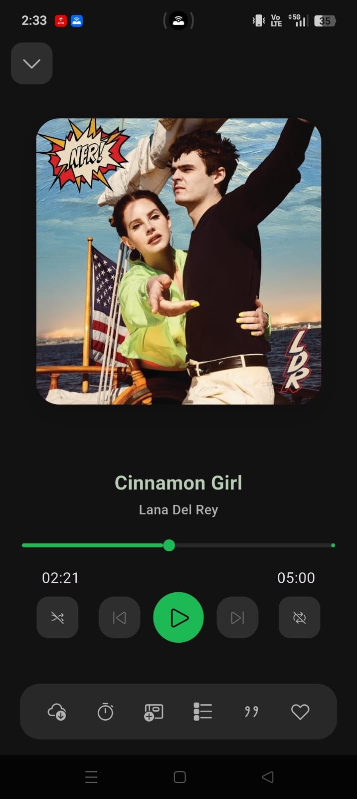
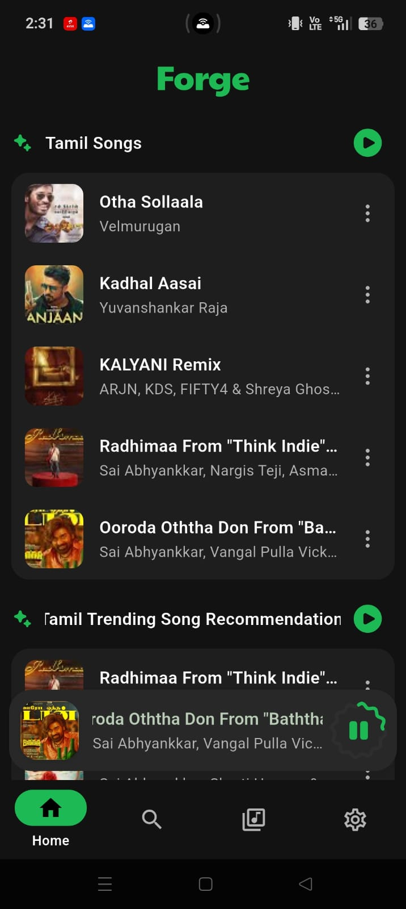

<div align="center">


# 🎵 Forge by Lokesh

### The High-Fidelity, Ad-Free Music Player for Android, macOS & Windows

**Crafted with passion, precision, and modern software engineering by Lokesh.**

[](https://github.com/lokesh12dev/Forge/releases/latest)
[](https://lokesh12dev.github.io/Forge/download/)
[](LICENSE)
[](https://lokesh12dev.github.io/Forge/download/)
[](https://flutter.dev)

<br />

### 🚀 [**👉 Open Official Landing & Download Portal**](https://lokesh12dev.github.io/Forge/download/)

[**Download Center**](https://lokesh12dev.github.io/Forge/download/) • [**Live Releases**](https://github.com/lokesh12dev/Forge/releases/latest) • [**Report an Issue**](https://github.com/lokesh12dev/Forge/issues) • [**Portfolio**](https://lokesh-online-three.vercel.app/pro) • [**GitHub**](https://github.com/lokesh12dev)

</div>

---

## ⚡ Quick Download Links

Click below to visit the official landing and download portal or download release files directly:

> 🌐 **Interactive Download Portal:** **[https://lokesh12dev.github.io/Forge/download/](https://lokesh12dev.github.io/Forge/download/)**  
> *(Automatically detects your operating system, provides SHA-256 verification hashes, and guides your installation)*

| Platform | Format / Architecture | File Size | Direct Download |
| :--- | :--- | :--- | :--- |
| 🍏 **macOS** | Universal Disk Image (`.dmg`) · macOS 12.0+ | **26.1 MB** | [**Forge-v10.6.6-macos.dmg**](https://github.com/lokesh12dev/Forge/releases/download/v10.6.6/Forge-v10.6.6-macos.dmg) |
| 🪟 **Windows** | Setup Installer (`-setup.exe`) · x64 | **17.8 MB** | [**Forge-v10.6.6-windows-setup.exe**](https://github.com/lokesh12dev/Forge/releases/download/v10.6.6/Forge-v10.6.6-windows-setup.exe) |
| 🪟 **Windows** | Portable Archive (`.zip`) · x64 | **21.9 MB** | [**Forge-v10.6.6-windows-x64.zip**](https://github.com/lokesh12dev/Forge/releases/download/v10.6.6/Forge-v10.6.6-windows-x64.zip) |
| 🤖 **Android** | Universal APK · All Architectures | **32.0 MB** | [**Forge-v10.6.6-universal.apk**](https://github.com/lokesh12dev/Forge/releases/download/v10.6.6/Forge-v10.6.6-universal.apk) |
| 🤖 **Android** | ARM64 APK · arm64-v8a Devices | **12.7 MB** | [**Forge-v10.6.6-arm64-v8a.apk**](https://github.com/lokesh12dev/Forge/releases/download/v10.6.6/Forge-v10.6.6-arm64-v8a.apk) |
| 🔐 **Checksums** | SHA-256 Digest for All Platforms | **472 B** | [**SHA256SUMS.txt**](https://github.com/lokesh12dev/Forge/releases/download/v10.6.6/SHA256SUMS.txt) |

*File sizes are shown in binary megabytes (MiB), matching the official download portal; in decimal MB the same assets measure ~5% more (e.g. the DMG is 27.3 decimal MB).*

---

## 🛠️ Complete Installation Instructions

<details open>
<summary><b>🍏 macOS Installation Guide</b></summary>

1. Download [**Forge-v10.6.6-macos.dmg**](https://github.com/lokesh12dev/Forge/releases/download/v10.6.6/Forge-v10.6.6-macos.dmg).
2. Double-click the `.dmg` file to open it.
3. Drag **Forge.app** into your **Applications** folder.
4. **First Launch Note:** Because Forge is built independently and unsigned, macOS Gatekeeper may show an untrusted developer prompt. To open:
   - **Right-click** (or `Control + click`) on **Forge.app** in Finder.
   - Select **Open** from the context menu.
   - Click **Open** on the confirmation dialog. Subsequent launches open directly.
</details>

<details open>
<summary><b>🪟 Windows Installation Guide</b></summary>

1. Download [**Forge-v10.6.6-windows-setup.exe**](https://github.com/lokesh12dev/Forge/releases/download/v10.6.6/Forge-v10.6.6-windows-setup.exe) for a guided installer, or download [**Forge-v10.6.6-windows-x64.zip**](https://github.com/lokesh12dev/Forge/releases/download/v10.6.6/Forge-v10.6.6-windows-x64.zip) for standalone portable usage.
2. Launch the installer or extract the `.zip` archive to your desired directory.
3. **SmartScreen Note:** Windows Defender SmartScreen may display an *"Unknown Publisher"* warning. Click **More info**, then click **Run anyway**.
4. Enjoy high-performance native audio with libmpv integration!
</details>

<details open>
<summary><b>🤖 Android Installation Guide</b></summary>

1. Download [**Forge-v10.6.6-universal.apk**](https://github.com/lokesh12dev/Forge/releases/download/v10.6.6/Forge-v10.6.6-universal.apk) on your device.
2. Open the downloaded `.apk` file.
3. If prompted by Android, enable **Install from unknown sources** for your browser or file manager.
4. Tap **Install** and launch Forge.
</details>

---

## 🛡️ Verify Your Download (SHA-256)

Every release publishes official cryptographic checksums in `SHA256SUMS.txt`.

**On macOS / Linux:**
```bash
shasum -a 256 -c SHA256SUMS.txt
```

**On Windows (PowerShell):**
```powershell
Get-FileHash .\Forge-v10.6.6-windows-setup.exe -Algorithm SHA256
```

Official Release Checksums for v10.6.6:
```
e200b5764f22ee4f0f289ea60f05a3f45c9e7674495fa2a21103887325ece5fb  Forge-v10.6.6-macos.dmg
59e07bd812397b363d7a86ea30f7a74751e95bbeac9328984bc1f4174a6ae451  Forge-v10.6.6-windows-setup.exe
0613092c422dba5ac1e9416b24205209cc4e0382766804ec9e7364a54f53446c  Forge-v10.6.6-windows-x64.zip
3e167563ce31491ecdf3d0e79507ccf8a629d90d58a04900fb4471754c4ab1bf  Forge-v10.6.6-universal.apk
8090ad27cafe4f999ea704016a1aff5a30cda8c719098032830d9113a67b17ca  Forge-v10.6.6-arm64-v8a.apk
```

---

## 📸 Screenshots

<div align="center">
  
  &nbsp;&nbsp;&nbsp;&nbsp;
  
</div>

---

## 🌟 Top-Tier Features

### 🎧 High-Fidelity Audio Architecture
- Native low-latency audio playback pipeline with gapless playback, lock-screen controls, and system media integration across Android, macOS, and Windows.
- Intelligent multi-stream caching ensures smooth playback even under unstable network conditions.

### 🖥️ Pinned "Forge by Lokesh" Desktop Chrome
- **Permanent Top Bar Visibility:** The centered **Forge by Lokesh** brand heading remains razor-sharp and visible when scrolling down, scrolling up, or expanding into full-screen and maximized views.
- **Fluid Multi-View Adaptation:** Side view, minimized view, and maximized full-screen modes dynamically adjust grid cards, spacing, and album textures.

### 🔍 Music-Focused Search Engine
- Powered by official YouTube Music search suggestion endpoints, providing pure song names, artist profiles, and album queries.
- Strict search sanitization automatically filters out generic web search clutter (*download*, *lyrics*, *ringtone*, *whatsapp status*), ensuring clean, music-only discovery.

### 📻 Dynamic Home Feed Experience
- **Quick Access Chips:** Instant one-click playback for Liked Songs, Tamil Hits, Trending Global, and Offline Downloads.
- **New Release Spotlight:** Dedicated artist spotlight featuring cover art, track credits, and instant playback.
- **Albums Featuring Songs You Like:** Textured album cards with smooth hover elevation and circular play buttons.
- **Recents Carousel:** Live personal listening history connected to local storage.
- **Curated Trending Tracks:** Hand-picked trending collections spanning Tamil hits and international releases.

### 📝 Real-Time Synchronized Lyrics
- Accurate real-time LRC synchronized scrolling lyrics with smooth timing and active line highlighting.

### 🔒 Privacy-First & Local Storage
- **100% Local-First:** Playlists, listening history, and downloaded songs reside safely on your device.
- **Zero Tracking:** No telemetry bloat, no mandatory user accounts, and zero third-party tracking scripts.

---

## 🏗️ Architecture & Technologies

Forge is engineered with a modular, reactive architecture:

```
lib/
├── constants/        Design tokens, clients, and app-wide constants
├── database/         Hive-backed local databases (playlists, albums, radio)
├── models/           Strongly-typed immutable data models
├── screens/          Feature screens (Home, About, Search, Library, Now Playing)
├── services/         Playback coordinator, router, lyrics, audio services
├── theme/            Material 3 theme configuration and dark palette tokens
├── utilities/        Formatters, URL launchers, and image caching utilities
└── widgets/          Reusable desktop chrome, cards, bars, and lyric visualizers
```

### 💻 Languages & Frameworks Used
- **Dart & Flutter:** Cross-platform reactive UI, declarative state routing, and multi-platform rendering.
- **C++ & libmpv:** High-performance native audio backend, stream decoding, and Windows runtime bridge.
- **Swift & Objective-C:** macOS native runner, ad-hoc codesigning configuration, and system audio integration.
- **JavaScript, HTML & CSS:** Official Forge release portal, release API integration, responsive layout design, and Playwright verification.
- **Python:** Desktop startup performance analysis, automated icon verification, and static link checking.
- **GitHub Actions & CI/CD:** Automated multi-platform build matrices (macOS & Windows runners), Inno Setup installer compilation, and DMG packaging.

---

## 👨‍💻 Creator & Engineering Journey

<div align="center">

### Built with Passion & Relentless Dedication by **Lokesh**

[](https://lokesh-online-three.vercel.app/pro)
[](https://github.com/lokesh12dev)

</div>

> *"Building Forge has been an intense, relentless journey of personal dedication, passion, and countless hours of deep focus. What started as an ambitious vision evolved through endless nights of debugging complex native audio pipelines, optimizing platform-specific rendering, and solving challenging cross-platform audio hurdles across Linux, macOS, and Windows.*  
>  
> *Every single line of code, every UI animation, every CI/CD workflow, and every asset packaging pipeline was shaped by patience, persistence, and continuous self-learning. All work in this application was designed and engineered by Lokesh, fueled by an uncompromising standard for craft and an enduring belief in building software that people truly love to use."*

---

## 🔨 Building From Source

### Prerequisites
- Flutter 3.47.7+ (stable channel)
- Dart 3.13+
- Java 17+ & Android SDK 36 (for Android)
- Xcode 15+ (for macOS)
- Visual Studio 2022 with C++ Desktop Workload (for Windows)

```bash
# Clone the repository
git clone https://github.com/lokesh12dev/Forge.git
cd Forge

# Fetch dependencies
flutter pub get

# Run static analysis
flutter analyze --no-fatal-infos

# Run unit tests
flutter test

# Build for your platform
flutter build macos --release       # macOS
flutter build windows --release     # Windows
flutter build apk --release         # Android
```

---

## 🆕 Changelog

### v10.6.6 — UPI Sponsorship Polish *(Latest)*
- 🎯 **Sponsor button auto-opens Google Pay on Android** — tapping "Sponsor the Project" in Settings immediately triggers Google Pay (or any UPI app)
- ✅ **Direct UPI launch** — skips `canLaunchUrl()` pre-check; calls `launchUrl()` directly for instant response
- 📋 **Auto-copy UPI ID on failure** — if no UPI app is installed, UPI ID copies to clipboard automatically with a helpful snackbar
- 💚 **Dynamic button label** — dialog shows "Pay with Google Pay" or "Pay with PhonePe" based on selected tab
- 🤖 **Android manifest** — declared `upi://` scheme and all major UPI app packages in `<queries>` block
- 🍎 **iOS plist** — added `LSApplicationQueriesSchemes` for `upi`, `gpay`, `phonepe`, `paytmmp`

### v10.6.5 — Dual UPI Sponsorship Experience
- 💰 Dual UPI sponsorship dialog with Google Pay + PhonePe QR codes
- 📱 QR tap-to-enlarge, Copy UPI ID, Open UPI App
- 🏷️ Payees verified: `mr.mlokesh7@oksbi` (GPay) · `7603883879@axl` (PhonePe)
- 🔐 All QR codes decoded and verified — no fabricated UPI IDs

---

## 📄 License

Forge is licensed under the [GNU General Public License v3.0](LICENSE).  
Engineered with ❤️ by **Lokesh**.
